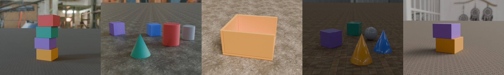
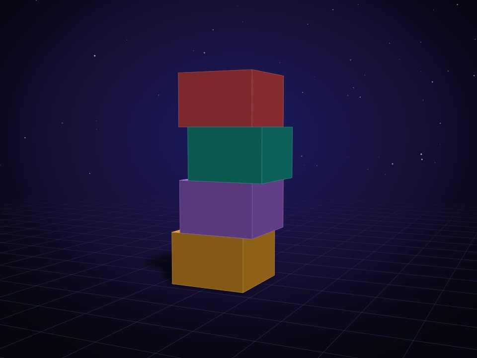
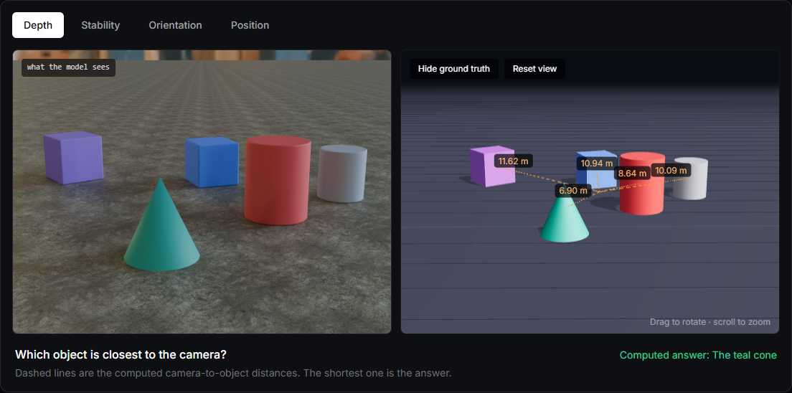
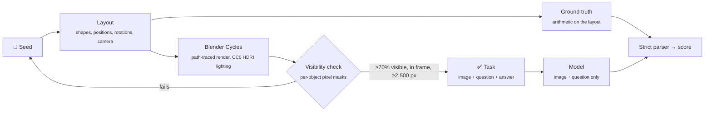
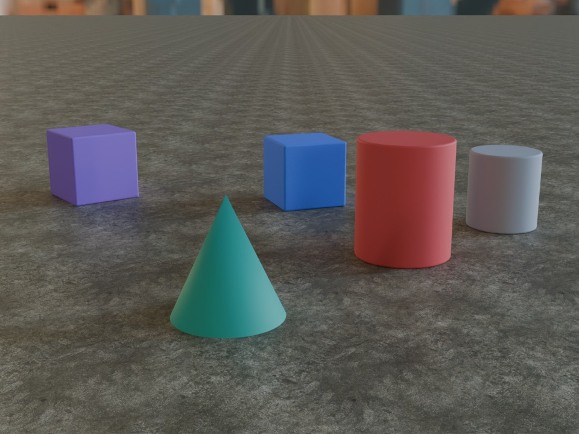
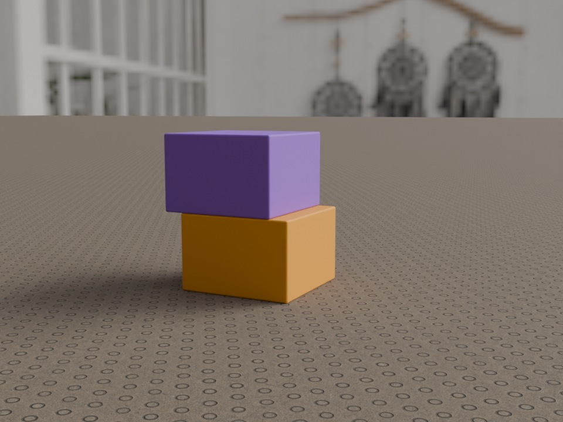
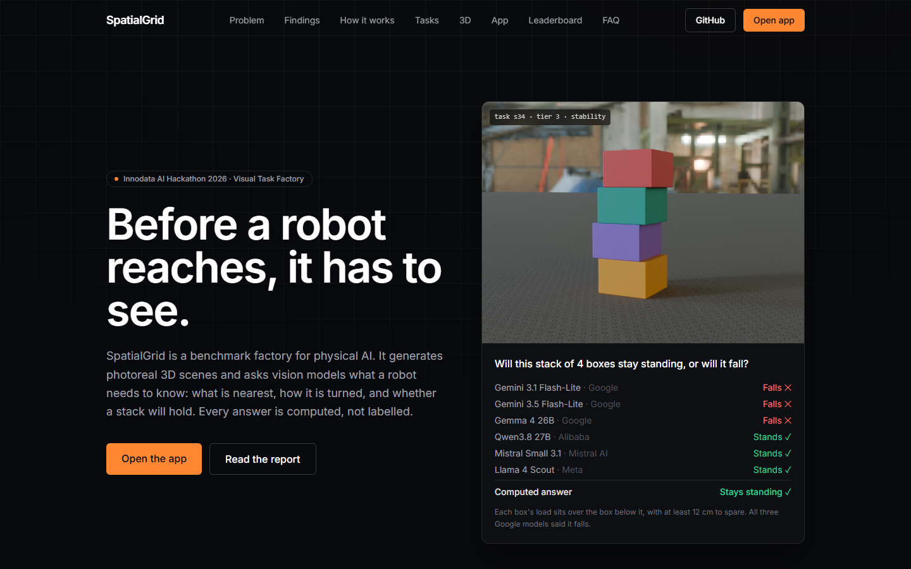
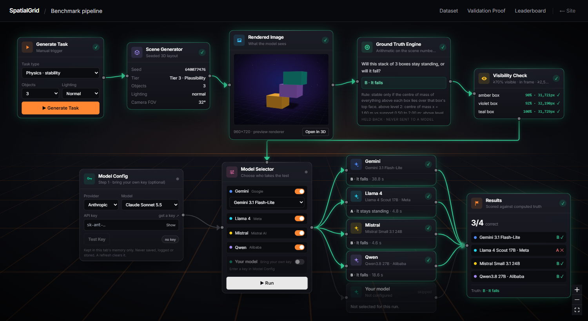

<p align="center">
  
</p>

<h1 align="center">SpatialGrid</h1>

<p align="center">
  <b>Before a robot reaches, it has to see.</b><br>
  A benchmark factory that tests whether vision-language models can judge <b>depth</b>, <b>pose</b> and <b>physical stability</b>,<br>
  the perception a robot arm or inspection camera relies on. Every answer is computed, never labelled.
</p>

<p align="center">
  <a href="https://github.com/Noufalthecoder/innodata/actions/workflows/ci.yml"></a>
  
  
  
  
</p>

<p align="center">
  <a href="docs/TECHNICAL_REPORT.md"><b>Technical report</b></a> ·
  <a href="#quick-start"><b>Run it</b></a> ·
  <a href="#see-it-in-3d"><b>3D view</b></a> ·
  <a href="#results"><b>Results</b></a> ·
  <a href="docs/DEMO_SCRIPT.md"><b>Demo script</b></a>
</p>

<p align="center"><sub>Innodata AI Hackathon 2026 · Track 2: Visual Task Factory</sub></p>

---

## One scene, two camps

<table>
<tr>
<td width="50%"></td>
<td>

**Task s34 · Tier 3 · Stability**<br>
*Will this stack of 4 boxes stay standing, or will it fall?*

| Model | Answer |
|---|---|
| Gemini 3.1 Flash-Lite (Google) | Falls ❌ |
| Gemini 3.5 Flash-Lite (Google) | Falls ❌ |
| Gemma 4 26B (Google) | Falls ❌ |
| Qwen3.8 27B (Alibaba) | Stands ✅ |
| Mistral Small 3.1 (Mistral AI) | Stands ✅ |
| Llama 4 Scout (Meta) | Stands ✅ |
| **Computed** | **Stays standing ✅** |

The load on every box sits over the box below it, with at least 12 cm to spare. We know because we placed every box ourselves.

</td>
</tr>
</table>

Vision models are being wired into robot arms, warehouse pickers and inspection cameras. Most benchmarks check whether a model can *describe* a picture. SpatialGrid checks whether it can be trusted to *act* on one.

| If the model misjudges… | …in a warehouse, this happens |
|---|---|
| **Depth**: which item is nearest | The arm reaches for the wrong item, or hits one it never saw |
| **Pose**: which way it is turned | The gripper approaches from the closed side and the grasp fails |
| **Stability**: whether a stack holds | An unsafe pallet passes inspection, or a safe one halts the line |

## Results

Six vision models from four companies, 60 photoreal tasks each, image plus question, temperature 0, hidden reasoning off. Only complete runs are reported.

| Model | Company | Overall | Tier 1 · Orientation | Tier 2 · Depth & position | Tier 3 · Stability | Dim light |
|---|---|:-:|:-:|:-:|:-:|:-:|
| Qwen3.8 27B | Alibaba (open weights) | **88.3%** | 50% | 97% | 95% | 92% |
| Gemini 3.1 Flash-Lite | Google | **81.7%** | 50% | 97% | 75% | 100% |
| Mistral Small 3.1 24B | Mistral AI (open weights) | **81.7%** | 30% | 90% | 95% | 75% |
| Gemma 4 26B | Google (open weights) | **80.0%** | 70% | 100% | 55% | 83% |
| Gemini 3.5 Flash-Lite | Google | **75.0%** | 20% | 90% | 80% | 83% |
| Llama 4 Scout 17B | Meta (open weights) | **70.0%** | 40% | 67% | 90% | 75% |

**What we found**

- 🟢 **Depth and position are nearly solved: 90% on average.** Five of six models score 90–100%, with up to five objects and partial occlusion. Llama 4 Scout is the exception at 67%.
- 🟠 **Orientation is weak for every company's model: 43% on average, against 25% for guessing.** The models collapse onto "toward" or "away from" the camera. Out of 60 orientation answers, only one said "left" or "right", although those are correct for 4 of the 10 tasks. Llama 4 answered "away from the camera" 10 times out of 10.
- 🟠 **Over-predicting collapse is a Google-family habit, not a universal one.** The three Google models caught all 10 unstable stacks but recognised only 1–6 of the 10 stable ones. Qwen, Mistral and Llama recognised all 10 stable stacks and still caught 8–9 of the 10 unstable ones.
- 🥇 **An open-weights model leads.** Alibaba's Qwen3.8 27B scored 88.3%, ahead of every Google model.
- ⚪ **Light made no consistent difference.** Some models did better in dim light and some worse, so the failures are about reasoning, not visibility.
- 🔴 **Three scenes defeated all six models.** Scenes s9, s27 and s57 are all containers whose open side faces right. They appear in the app's failure gallery.

## See it in 3D

<p align="center">
  
</p>

Every scene can be opened as a live 3D model, rebuilt in the browser from the same numbers that produced the image. The ground truth is drawn on the scene:

- the camera-to-object **distances** for depth,
- the **centre of mass** over each supporting face for stability,
- the **facing arrow** for orientation,
- **name tags** for position.

Drag to orbit and scroll to zoom. It's on the landing page under *Explore in 3D*, and on every task in the app.

<p align="center"></p>

## How it works

The answer exists before the image does.



1. **Choose the numbers.** A seed sets every object's shape, position, rotation and material, plus the camera.
2. **Render.** Blender path-traces the scene under real studio and workshop lighting (Poly Haven HDRIs), on PBR floors.
3. **Prove it is visible.** Each object is re-rendered as a flat-colour mask. An object under 70% visible, cut off by the frame or too small gets the task rebuilt from a new seed.
4. **Compute the answer.** The answer is distance, projection, rotation or centre of mass, worked out from the numbers alone. No labeller and no judge model are involved.
5. **Score.** The model receives only the image and the question. A strict parser reads its letter, and an ambiguous reply counts as wrong.

## The tasks

<table>
<tr>
<td align="center" width="25%"><br><b>Orientation</b><br><sub>Tier 1 · Pose</sub></td>
<td align="center" width="25%"><br><b>Depth</b><br><sub>Tier 2 · Relative</sub></td>
<td align="center" width="25%"><br><b>Position</b><br><sub>Tier 2 · Relative</sub></td>
<td align="center" width="25%"><br><b>Stability</b><br><sub>Tier 3 · Physics</sub></td>
</tr>
<tr>
<td><sub><i>The open side of this container faces which way?</i><br>From the container's yaw angle.</sub></td>
<td><sub><i>Which object is closest to the camera?</i><br>Smallest distance, by a 0.8 m margin.</sub></td>
<td><sub><i>Which object appears furthest to the left?</i><br>Perspective projection, by a 90 px margin.</sub></td>
<td><sub><i>Will this stack stay standing, or fall?</i><br>Centre of mass over support, by 12 cm.</sub></td>
</tr>
</table>

Each kind needs a different skill, not a reworded question. Within each kind, difficulty varies independently:

- **Objects:** 1–5, with partial occlusion. 46 of the 167 objects asked about are partly hidden.
- **Lighting:** normal and dim.
- **Environments:** 6 real-world HDRIs.
- **Floors:** 5 materials.
- **Object finish:** matte, plastic and metal.
- **Stacks:** 2–4 boxes, with stand and fall outcomes balanced 10 / 10.

## Why you can trust the numbers

| Check | Result |
|---|:-:|
| Answers re-derived by separate code ([`lib/bench/truth.ts`](lib/bench/truth.ts), shares no logic with the generator) | **60 / 60** |
| Tasks rebuilt identically from their seeds | **60 / 60** |
| Visibility check passed | **60 / 60** |
| Automated tests (`npm test`, run in CI on every push) | **85 / 85** |

The test suite also includes:

- **Property tests:** the generator and the independent re-derivation agree on 500 random stacks.
- **Mutation tests:** corrupted answers and altered scenes are caught by the validators.
- **Prompt-safety tests:** the answer never reaches the model.
- **Dataset tests:** stability outcomes stay balanced between 40% and 60%.

The tests caught two real bugs during development:

1. A regex escaping error turned "Answer: D" into "no answer".
2. A generator bias made 19 of 20 stacks stand, so a model that always said "stands" would have scored 95%.

Both are documented in the [technical report](docs/TECHNICAL_REPORT.md).

## How this maps to the judging criteria

| Criterion | Where to look |
|---|---|
| **Implementation (25%)** | One command each to generate, validate, evaluate and report. It is resumable, quota-aware and covered by CI. See [`scripts/bench/`](scripts/bench), [`lib/bench/`](lib/bench) and [`scripts/blender/render.py`](scripts/blender/render.py). |
| **Validity (25%)** | Ground truth is computed and then independently re-derived. Exact visibility comes from pixel masks. The suite has 85 tests, including mutation tests. See [Why you can trust the numbers](#why-you-can-trust-the-numbers). |
| **Variation (20%)** | 4 reasoning kinds across 3 tiers, 1–5 objects, occlusion, 2 lighting levels, 6 environments, 5 floors and 3 materials, with balanced outcomes. |
| **Originality (15%)** | Answers are fixed before rendering; the visibility check proves every question is answerable; scenes can be explored as live 3D with the truth overlaid. |
| **Impact (15%)** | The failure modes map directly to robot grasping and pallet inspection, and the orientation and stability blind spots are measurable. See [Results](#results). |

## Quick start

```bash
npm install
cp .env.example .env.local        # add GEMINI_API_KEY (free tier works) to evaluate models
npm run dev                        # landing page at http://localhost:3000, app at /app
```

The shipped dataset (60 tasks, images and model results) is already in [`public/bench/`](public/bench), so the site and app work right after `npm install`.

### Generate your own dataset

Photoreal rendering needs [Blender](https://www.blender.org/download/) (4.5 LTS tested) and free CC0 assets from Poly Haven:

```bash
node scripts/blender/fetch-assets.mjs                  # HDRI lighting + floor materials into assets/ (git-ignored)
# set BLENDER_PATH in .env.local
npm run bench:generate -- --count 60 --seed 1          # path-traced, about 1 minute per image on CPU
npm run bench:generate -- --count 60 --renderer svg    # instant preview renderer, no Blender needed
```

### Validate, evaluate and report

```bash
npm run bench:validate                                         # re-derives every answer, rebuilds from seeds
npm run bench:eval -- --model gemini --model-id gemini-3.1-flash-lite
npm run bench:report                                           # writes public/bench/summary.json
npm test                                                       # 85 tests
```

Open models run free through Cloudflare (`--model cloudflare --model-id @cf/qwen/qwen3.8-27b`). Claude (`--model anthropic`) and GPT-4o (`--model openai`) are supported as well. Evaluation resumes where it stopped, and it stops cleanly when a free quota runs out.

## The website and app

<p align="center"></p>

The app opens on **the pipeline itself**: a node graph in the style of n8n, built with React Flow, that runs the real generator and evaluator.

<p align="center"></p>

1. **Generate Task.** Pick a task type, object count and lighting. The Scene Generator, Rendered Image, Ground Truth and Visibility nodes fill in with the real output of the generator.
2. **Model Selector.** One lane per company: Gemini (Google), Llama 4 (Meta), Mistral, Qwen (Alibaba), and a paid GPT-4o / Claude lane. Switch each on or off. A model without an API key on the server is shown as not configured, never faked.
3. **Run.** Each model node moves through *running → done ✓ / failed ✕* live, edges animate while answers are in transit, and the **Results** node scores every answer against the computed truth.

Secondary panels, in the top bar:

| Panel | What it does |
|---|---|
| **Dataset** | Browse the 60 photoreal tasks as images or interactive 3D, with ground-truth overlays |
| **Validation Proof** | Re-derive every answer in the browser with independent code |
| **Leaderboard** | Accuracy by tier, kind and lighting, plus the scenes every model got wrong |

## Architecture

```
TypeScript (lib/bench)                         Blender (scripts/blender)
  layout + ground truth      ──tasks.json──▶     path-traced render (Cycles)
  seeds, styles               ◀─visibility──     exact per-object mask pixel counts
        │
        ├─ evaluate   Gemini · Llama · Mistral · Qwen · Claude · GPT-4o   scripts/bench/eval.ts
        ├─ validate   independent re-derivation            scripts/bench/validate.ts
        └─ report     accuracy by tier / kind / lighting   scripts/bench/report.ts

Next.js 15 + React Three Fiber (app, components)
  landing page, /app pipeline canvas (React Flow) + dataset, validation and leaderboard panels, live 3D viewer
```

```
lib/bench/        scene generation, ground truth, visibility, model clients, independent truth (truth.ts)
scripts/bench/    CLI: generate, eval, validate, report, reparse
scripts/blender/  render.py (Cycles renderer + exact visibility), fetch-assets.mjs
scripts/demo/     automated demo video: voice-over, browser recording, zoom and subtitles
app/, components/ landing page, /app, API routes, 3D viewer
public/bench/     shipped tasks, images, model results, summary
tests/bench/      vitest suite
```

### Environment variables (`.env.local`)

| Variable | Purpose |
|---|---|
| `GEMINI_API_KEY` | Gemini and Gemma evaluation (free tier) |
| `CLOUDFLARE_ACCOUNT_ID`, `CLOUDFLARE_API_TOKEN` | Llama 4, Mistral and Qwen through Cloudflare Workers AI (free tier) |
| `ANTHROPIC_API_KEY` | Claude evaluation (optional) |
| `OPENAI_API_KEY` | GPT-4o evaluation (optional) |
| `BLENDER_PATH` | Blender executable for photoreal rendering |

Keys are read on the server only and never sent to the browser.

## Limitations

- **Synthetic scenes.** They are controlled by design, but they are not photographs of real warehouses.
- **Simplified stability.** It uses a centre-of-mass rule for equal-size, equal-density boxes, not a full physics simulation.
- **Small per-tier samples.** 60 tasks give wide confidence intervals (about ±15 points for 10 tasks). The generator can make any number; the limit was free API quota.
- **No closed commercial models besides Gemini.** Claude and GPT-4o are supported by the code but were not run for cost reasons, and we report only what we ran.

## Credits

- **HDRI lighting and floor materials:** [Poly Haven](https://polyhaven.com), CC0.
- **Renderer:** [Blender](https://www.blender.org) (GPL). The rendering script only drives it.
- **Built with:** Next.js, React Three Fiber, Tailwind CSS, Framer Motion and vitest.
