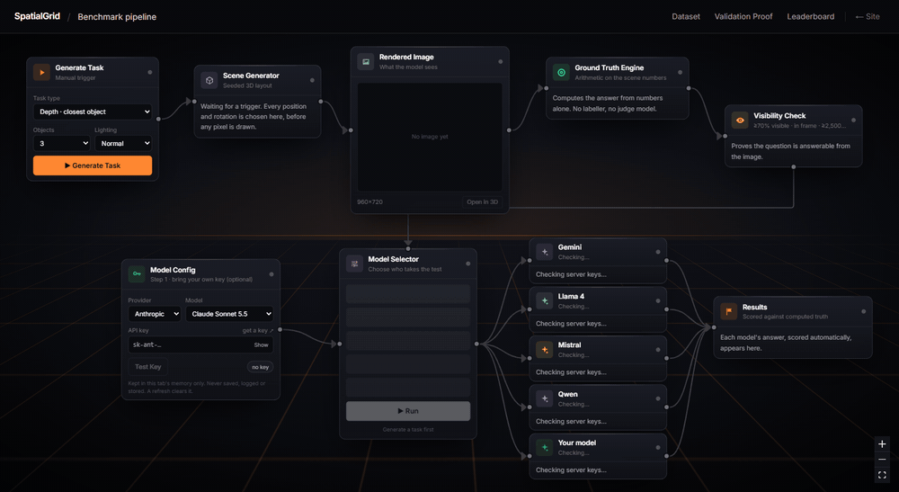
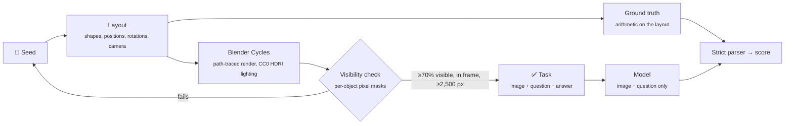
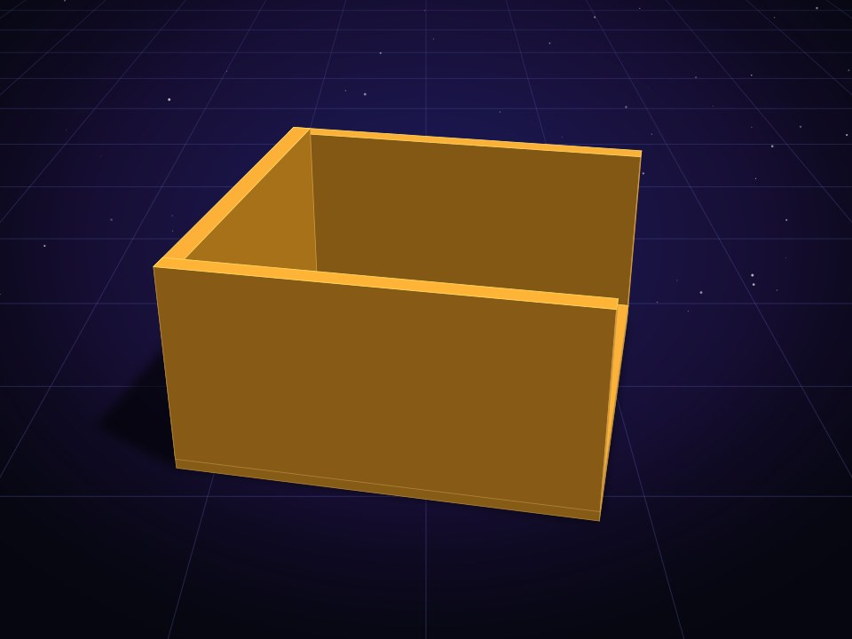
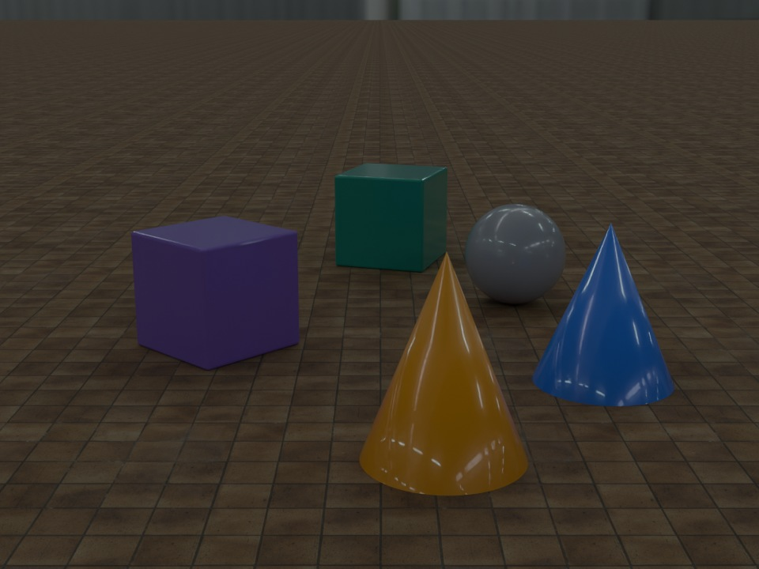
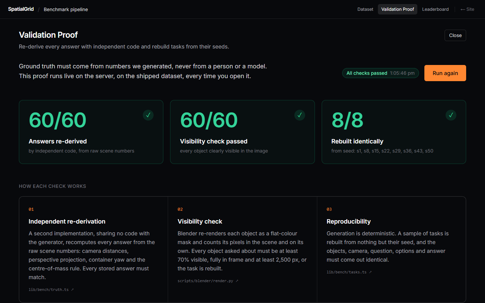
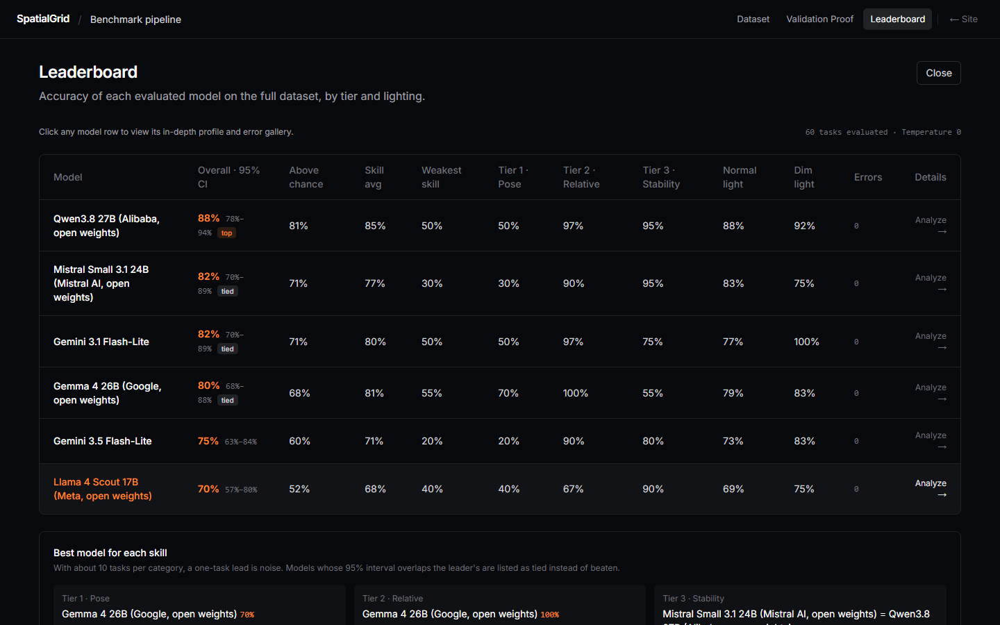
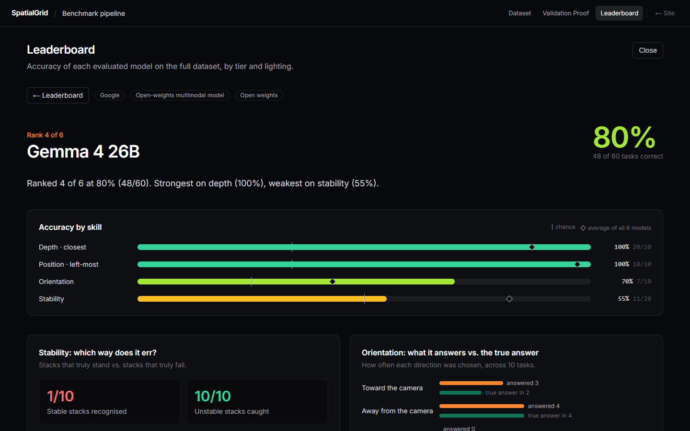
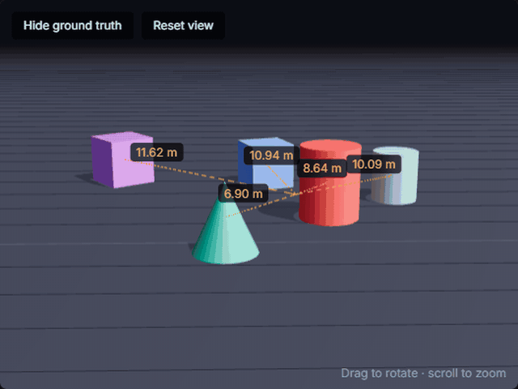

<p align="center">
  
</p>

<h1 align="center">SpatialGrid</h1>

<p align="center">
  <b>Before a robot reaches, it has to see.</b><br>
  A benchmark factory that tests whether vision-language models can judge <b>depth</b>, <b>pose</b> and <b>physical stability</b>:<br>
  the perception a robot arm or an inspection camera depends on. <b>Every answer is computed before the image exists.</b>
</p>

<p align="center">
  <a href="https://github.com/Noufalthecoder/innodata/actions/workflows/ci.yml"></a>
  
  
  
  
  
</p>

<p align="center">
  <a href="#-results"><b>Results</b></a> ·
  <a href="#-watch-it-run"><b>Live pipeline</b></a> ·
  <a href="#-why-you-can-trust-the-numbers"><b>Validation</b></a> ·
  <a href="#-quick-start"><b>Run it</b></a> ·
  <a href="docs/TECHNICAL_REPORT.md"><b>Technical report</b></a> ·
  <a href="docs/PROJECT_OVERVIEW.md"><b>Project overview</b></a>
</p>

<p align="center"><sub>Team Hackcrew · Innodata AI Hackathon 2026 · Track 2: Visual Task Factory</sub></p>

---

## In one minute

| | |
|---|---|
| **The problem** | Vision-language models are being wired into robot arms, warehouse pickers and inspection cameras. To test them, someone has to label images by hand. That is slow, expensive, and for 3D questions ("which way is it turned?", "will this stack hold?") even careful people disagree. |
| **Our answer** | Don't label at all. SpatialGrid chooses every object's position, rotation and the camera *first*, computes the answer from those numbers, and only then renders a photoreal image. It produces as many tasks as you want, with labels that cannot be wrong. |
| **The proof** | 60 path-traced tasks. Every answer re-derived by independent code (60/60), every image visibility-checked (60/60), every task rebuilt identically from its seed. 116 automated tests run in CI. |
| **What we found** | Across six models from Google, Alibaba, Mistral AI and Meta, **depth is nearly solved (90%)**, **orientation is not (43%)**, and **Google's models call most safe stacks unsafe** while the others get all ten right. |

## One scene, two camps

<table>
<tr>
<td width="50%"></td>
<td>

**Task s34 · Tier 3 · Stability**<br>
*Will this stack of 4 boxes stay standing, or will it fall?*

| Model | Answer |
|---|---|
| Gemini 3.1 Flash-Lite · Google | Falls ❌ |
| Gemini 3.5 Flash-Lite · Google | Falls ❌ |
| Gemma 4 26B · Google | Falls ❌ |
| Qwen3.8 27B · Alibaba | Stands ✅ |
| Mistral Small 3.1 · Mistral AI | Stands ✅ |
| Llama 4 Scout · Meta | Stands ✅ |
| **Computed** | **Stays standing ✅** |

The load on every box sits over the box below it, with at least 12 cm to spare. We know because we placed every box ourselves.

</td>
</tr>
</table>

| If the model misjudges… | …in a warehouse, this happens |
|---|---|
| **Depth**: which item is nearest | The arm reaches for the wrong item, or hits one it never saw |
| **Pose**: which way it is turned | The gripper approaches from the closed side and the grasp fails |
| **Stability**: whether a stack holds | An unsafe pallet passes inspection, or a safe one halts the line |

## 🎬 Watch it run

<p align="center">
  
</p>

The app opens on the benchmark itself, as a live node graph. **Generate Task** builds a fresh scene, and the image, computed answer and visibility report appear in order. **Run** then sends only the image and question to every selected model at once. Each lane turns green or red as its answer arrives, and **Results** scores them against the truth. *Recorded from the real app; nothing is mocked.*

## 📊 Results

Six vision models from four companies, 60 photoreal tasks each, identical prompt, temperature 0, hidden reasoning off.

| # | Model | Company | Overall · 95% CI | Above chance | Orientation | Depth & position | Stability | Dim light |
|:-:|---|---|:-:|:-:|:-:|:-:|:-:|:-:|
| 1 | Qwen3.8 27B | Alibaba · open | **88.3%** · 78–94 | 81% | 50% | 97% | 95% | 92% |
| 2 | Gemini 3.1 Flash-Lite | Google | **81.7%** · 70–89 | 71% | 50% | 97% | 75% | 100% |
| 2 | Mistral Small 3.1 24B | Mistral AI · open | **81.7%** · 70–89 | 71% | 30% | 90% | 95% | 75% |
| 4 | Gemma 4 26B | Google · open | **80.0%** · 68–88 | 68% | 70% | 100% | 55% | 83% |
| 5 | Gemini 3.5 Flash-Lite | Google | **75.0%** · 63–84 | 60% | 20% | 90% | 80% | 83% |
| 6 | Llama 4 Scout 17B | Meta · open | **70.0%** · 57–80 | 52% | 40% | 67% | 90% | 75% |

<sub>95% CI: Wilson interval. "Above chance" rescales accuracy so that random guessing scores 0 and perfect scores 100. Chance is 25% for orientation, 50% for stability and 20–50% for depth and position.</sub>

### What we found

1. **Depth and position are nearly solved: 90% on average.** Five of the six models score 90–100%, with up to five objects and partial occlusion. Llama 4 Scout is the exception at 67%.
2. **Orientation is broken for every company's model: 43% on average, against 25% for guessing.** The models collapse onto "toward" or "away from" the camera. Out of 60 orientation answers, **only one** said "left" or "right", although those are correct for 4 of the 10 tasks. Llama 4 answered "away from the camera" 10 times out of 10.
3. **Calling safe stacks unsafe is a Google-family habit, not a universal one.** The three Google models caught all 10 unstable stacks but recognised only **1–6 of the 10 stable ones**. Qwen, Mistral and Llama recognised **all 10** and still caught 8–9 unstable ones. Testing a single vendor would have hidden this.
4. **An open-weights model scored highest.** Qwen3.8 27B reached 88.3%. On paired answers (exact McNemar test), its lead is significant over Llama 4 (p = 0.007) and Gemini 3.5 Flash-Lite (p = 0.02), but not over Mistral, Gemini 3.1 or Gemma (p ≈ 0.27–0.29). With 60 tasks, those four are statistically tied.
5. **Light made no consistent difference.** Some models did better in dim light and some worse, so the failures come from reasoning, not from visibility.
6. **Three scenes defeated all six models:** s9, s27 and s57, all containers whose open side faces right.

## 💡 Why this matters for evaluation data

Model evaluation runs on labelled data, and labels are the weak link: they cost money, take time, and quietly carry the labeller's mistakes into every score. SpatialGrid shows a different way to build an evaluation set for spatial reasoning:

- **Labels that cannot be wrong.** The answer is arithmetic on numbers we chose (a distance, a projection, a rotation, a centre of mass), checked again by independent code.
- **No annotators and no judge model.** No person and no AI decides what is correct.
- **Unlimited, controllable data.** Any number of tasks from a seed, with difficulty dials for object count, occlusion, lighting, materials and stack height, and balanced outcomes.
- **Answerable by construction.** Pixel-level visibility masks prove that the evidence for every answer is actually in the image.

## ⚙️ How it works



1. **Choose the numbers.** A seed sets every object's shape, position, rotation and material, and the camera.
2. **Render.** Blender path-traces the scene under real studio and workshop lighting (Poly Haven HDRIs), on PBR floors.
3. **Prove it is visible.** Each object is re-rendered as a flat-colour mask. Under 70% visible, cut off by the frame or too small, and the task is rebuilt from a new seed.
4. **Compute the answer.** Distance, projection, rotation or centre of mass, from the numbers alone.
5. **Score.** The model receives only the image and the question. A strict parser reads its letter; an ambiguous reply counts as wrong.

## 🧩 The tasks

<table>
<tr>
<td align="center" width="25%"><br><b>Orientation</b><br><sub>Tier 1 · Pose</sub></td>
<td align="center" width="25%"><br><b>Depth</b><br><sub>Tier 2 · Relative</sub></td>
<td align="center" width="25%"><br><b>Position</b><br><sub>Tier 2 · Relative</sub></td>
<td align="center" width="25%"><br><b>Stability</b><br><sub>Tier 3 · Physics</sub></td>
</tr>
<tr>
<td><sub><i>The open side of this container faces which way?</i><br>From the container's yaw angle.</sub></td>
<td><sub><i>Which object is closest to the camera?</i><br>Smallest distance, by a 0.8 m margin.</sub></td>
<td><sub><i>Which object appears furthest to the left?</i><br>Perspective projection, by a 90 px margin.</sub></td>
<td><sub><i>Will this stack stay standing, or fall?</i><br>Centre of mass over support, by 12 cm.</sub></td>
</tr>
</table>

Each kind needs a different skill, not a reworded question. Within each kind, difficulty varies independently:

| Dial | Range |
|---|---|
| Objects | 1–5, with partial occlusion (46 of the 167 objects asked about are partly hidden) |
| Lighting | normal and dim |
| Environments | 6 real-world HDRIs: photo studios, workshops, a garage |
| Materials | 5 floors; matte, plastic and metal objects |
| Stacks | 2–4 boxes, stand / fall outcomes balanced 10 / 10 |

## ✅ Why you can trust the numbers

<p align="center"></p>

| Check | Result |
|---|:-:|
| Answers re-derived by separate code ([`lib/bench/truth.ts`](lib/bench/truth.ts), shares no logic with the generator) | **60 / 60** |
| Tasks rebuilt identically from their seeds | **60 / 60** |
| Visibility check passed | **60 / 60** |
| Automated tests (`npm test`, run in CI on every push) | **116 / 116** |

The proof runs live in the app (**Validation Proof**) every time it is opened. The test suite also covers:

- **Property and mutation tests.** The generator and the independent re-derivation agree on 500 random stacks, and corrupted answers or altered scenes are caught.
- **Prompt safety.** The answer never reaches a model, and ambiguous replies score as wrong.
- **Statistics.** Wilson intervals, chance-adjusted scores and the exact McNemar test are unit-tested.
- **Data integrity.** Every figure shown in the app is recomputed from the stored answers and must match the report. Hand-written notes may not contain numbers or model names, so nothing typed can drift from the data.
- **Key safety.** Bring-your-own keys are never stored, logged or echoed back.

The tests caught real bugs during development. A regex error silently turned "Answer: D" into "no answer". A generator bias made 19 of 20 stacks stand, so a model that always said "stands" would have scored 95%. Both are documented in the [technical report](docs/TECHNICAL_REPORT.md).

## 🖥️ The app

| | |
|---|---|
|  |  |
| **Leaderboard.** Confidence intervals, chance-adjusted scores, and models marked *tied* when the gap is not significant. | **Model deep-dive.** Skill bars against chance and the six-model average, stability and orientation diagnostics, and every task the model missed, with how all six models did on it. |

- **Pipeline.** The live node graph above: generate a task, then run Gemini, Llama, Mistral and Qwen side by side.
- **Bring your own key.** The **Model Config** node lets judges test the model they use (Anthropic, OpenAI, Google or OpenRouter). **Test Key** sends one tiny request first. The key lives in browser memory only, is sent only in the request that needs it, and is never stored, logged or returned. Provider errors come back as one plain sentence, such as "Invalid key for Anthropic. Check it and retry."
- **Dataset.** All 60 tasks as photoreal images or interactive 3D, with the ground truth drawn on the scene, plus export to JSON, CSV or JSONL.
- **Validation Proof.** The three checks above, run live.

### See any scene in 3D

<p align="center">
  
</p>

Every scene can be opened as a live 3D model, rebuilt in the browser from the same numbers that produced the image, with the ground truth drawn on it: distances for depth, the centre of mass for stability, a facing arrow for orientation.

## 🏆 How this maps to the judging criteria

| Criterion | Where to look |
|---|---|
| **Implementation · 25%** | One command each to generate, validate, evaluate and report; resumable and quota-aware; a live pipeline app; CI on every push. [`lib/bench/`](lib/bench), [`scripts/bench/`](scripts/bench), [`scripts/blender/render.py`](scripts/blender/render.py). |
| **Validity · 25%** | Computed ground truth, independently re-derived; pixel-mask visibility; 116 tests including mutation, statistics and data-integrity tests; confidence intervals and significance tests on every claim. |
| **Variation · 20%** | 4 reasoning kinds across 3 tiers; 1–5 objects with occlusion; 2 lighting levels; 6 environments; 5 floors; 3 materials; balanced outcomes. |
| **Originality · 15%** | Answers fixed before rendering; visibility proven per pixel; every scene explorable in 3D with its truth overlaid; a bring-your-own-key lane for any model. |
| **Impact · 15%** | Failure modes map directly to robot grasping and pallet inspection. Six models from four companies reveal a vendor-specific stability bias and a universal orientation blind spot. |

## 🚀 Quick start

```bash
npm install
cp .env.example .env.local        # add GEMINI_API_KEY (free tier) to run models
npm run dev                        # site at http://localhost:3000, app at /app
```

The shipped dataset (60 tasks, images and all model results) is in [`public/bench/`](public/bench), so the site and app work straight after `npm install`.

<details>
<summary><b>Generate your own dataset</b></summary>

Photoreal rendering needs [Blender](https://www.blender.org/download/) (4.5 LTS tested) and free CC0 assets from Poly Haven:

```bash
node scripts/blender/fetch-assets.mjs                  # HDRI lighting + floor materials into assets/ (git-ignored)
# set BLENDER_PATH in .env.local
npm run bench:generate -- --count 60 --seed 1          # path-traced, about 1 minute per image on CPU
npm run bench:generate -- --count 60 --renderer svg    # instant preview renderer, no Blender needed
```
</details>

<details>
<summary><b>Validate, evaluate and report</b></summary>

```bash
npm run bench:validate                                                   # re-derive every answer, rebuild from seeds
npm run bench:eval -- --model gemini --model-id gemini-3.1-flash-lite    # Google (free tier)
npm run bench:eval -- --model cloudflare --model-id @cf/qwen/qwen3.8-27b # open models via Cloudflare (free tier)
npm run bench:report                                                     # writes public/bench/summary.json
npm test                                                                 # 116 tests
```

Claude (`--model anthropic`), GPT-4o (`--model openai`) and OpenRouter (`--model openrouter`) are supported as well. Evaluation resumes where it stopped and stops cleanly when a free quota runs out.
</details>

<details>
<summary><b>Environment variables</b></summary>

| Variable | Purpose |
|---|---|
| `GEMINI_API_KEY` | Gemini and Gemma (free tier) |
| `CLOUDFLARE_ACCOUNT_ID`, `CLOUDFLARE_API_TOKEN` | Llama 4, Mistral and Qwen through Cloudflare Workers AI (free tier) |
| `ANTHROPIC_API_KEY` · `OPENAI_API_KEY` · `OPENROUTER_API_KEY` | Optional; visitors can also bring their own key in the app |
| `BLENDER_PATH` | Blender executable for photoreal rendering |

Keys are read on the server only and never sent to the browser.
</details>

## 🏗️ Architecture

```
TypeScript (lib/bench)                         Blender (scripts/blender)
  layout + ground truth      ──tasks.json──▶     path-traced render (Cycles)
  seeds, styles               ◀─visibility──     exact per-object mask pixel counts
        │
        ├─ evaluate   Gemini · Gemma · Llama · Mistral · Qwen · Claude · GPT-4o · OpenRouter
        ├─ validate   independent re-derivation (truth.ts)
        └─ report     accuracy, Wilson CIs, chance-adjusted scores, McNemar tests

Next.js 15 · React Flow · React Three Fiber
  landing page · /app pipeline canvas · dataset · validation proof · leaderboard + model deep-dives
```

```
lib/bench/         generation, ground truth, visibility, model clients, metrics, insights, BYOK
scripts/bench/     CLI: generate, eval, validate, report, reparse
scripts/blender/   render.py (Cycles renderer + exact visibility), fetch-assets.mjs
app/, components/  landing page, /app, API routes, 3D viewer
public/bench/      shipped tasks, images, per-model results, summary
tests/bench/       vitest suite
docs/              technical report, demo script, media
```

## Limitations

- **Synthetic scenes.** Controlled by design, but not photographs of real warehouses.
- **Simplified stability.** A centre-of-mass rule for equal-size, equal-density boxes, not a full physics simulation.
- **Small samples.** 60 tasks give wide intervals (about ±15 points for 10 tasks), which is why the leaderboard reports ties. The generator can make any number; the limit was free API quota.
- **Closed commercial models.** Claude and GPT-4o are supported, and can be run in the app with your own key, but were not part of our evaluation for cost reasons. We report only what we ran.

## Team and credits

Built for the Innodata AI Hackathon 2026 by **Team Hackcrew**: Mohammed Noufal V (team lead), DEVENDRAN-P, Adithya A M and KarthikeyanMahendran.

- **HDRI lighting and floor materials:** [Poly Haven](https://polyhaven.com), CC0.
- **Renderer:** [Blender](https://www.blender.org) (GPL). The rendering script only drives it.
- **Built with:** Next.js, React Flow, React Three Fiber, Tailwind CSS, Framer Motion and vitest.
