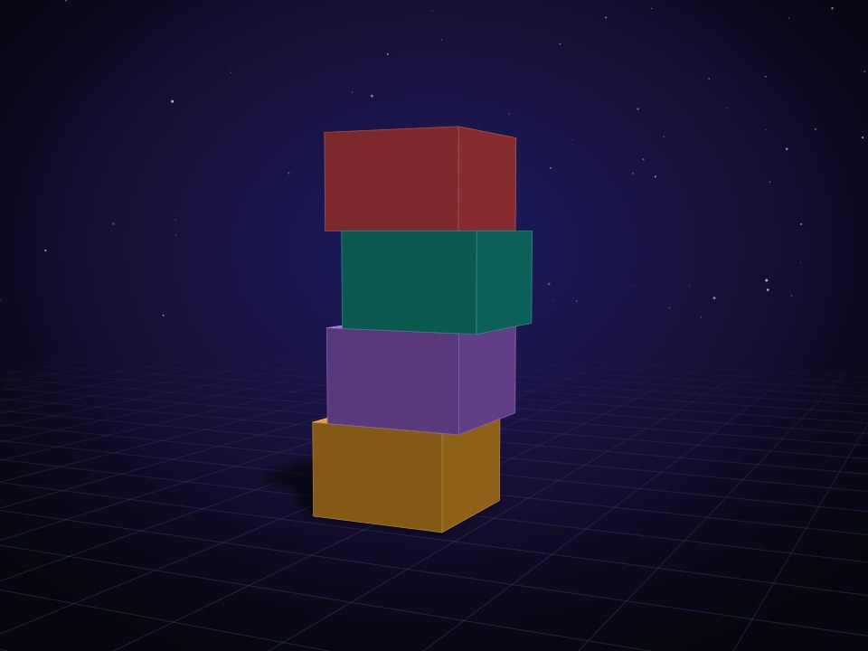
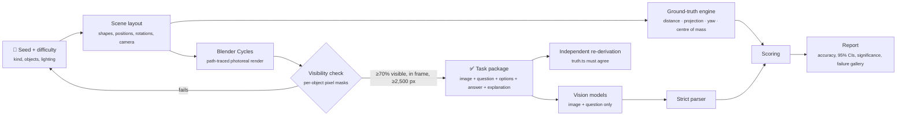
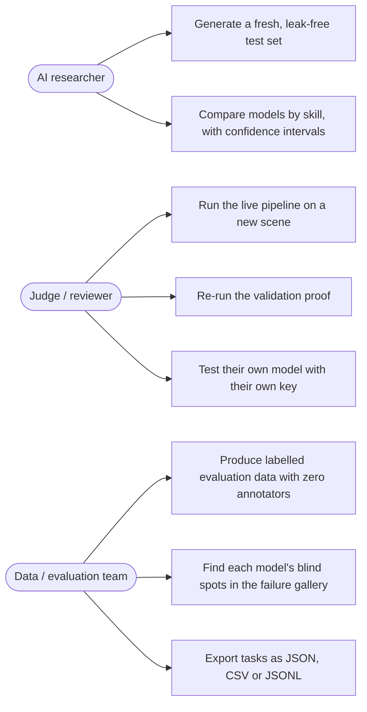
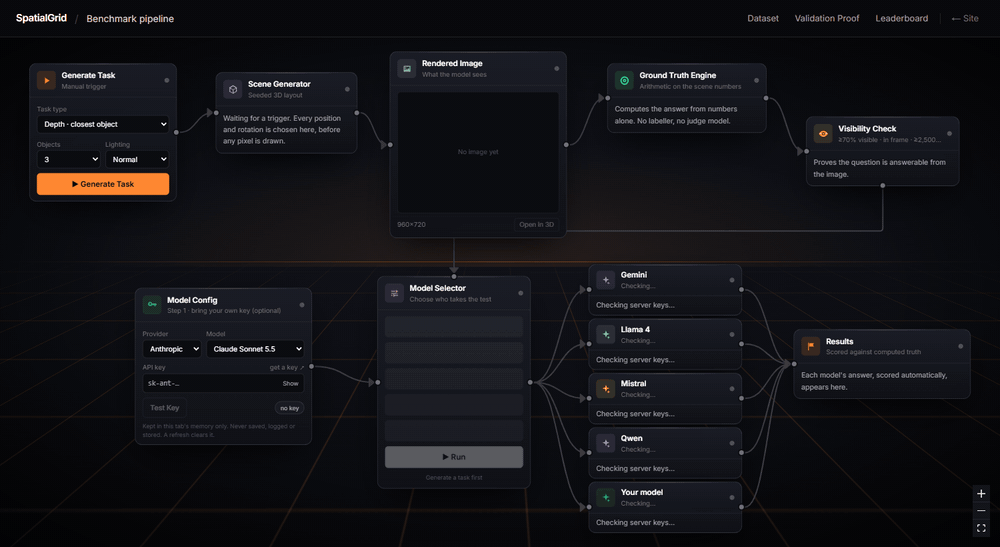
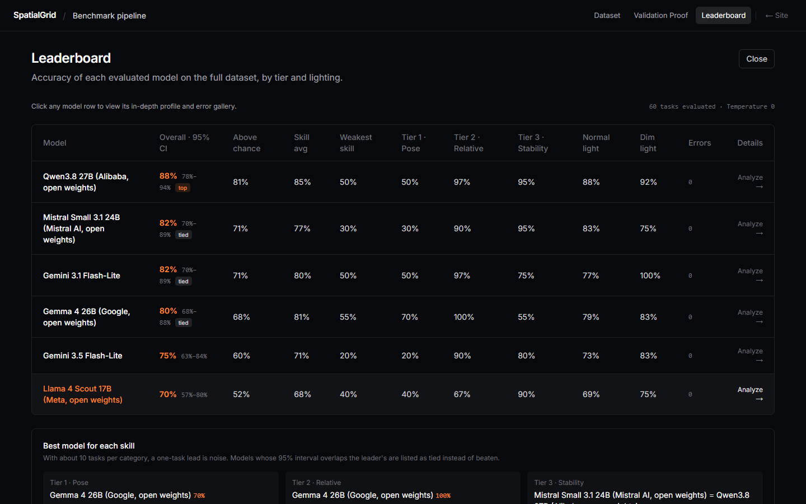
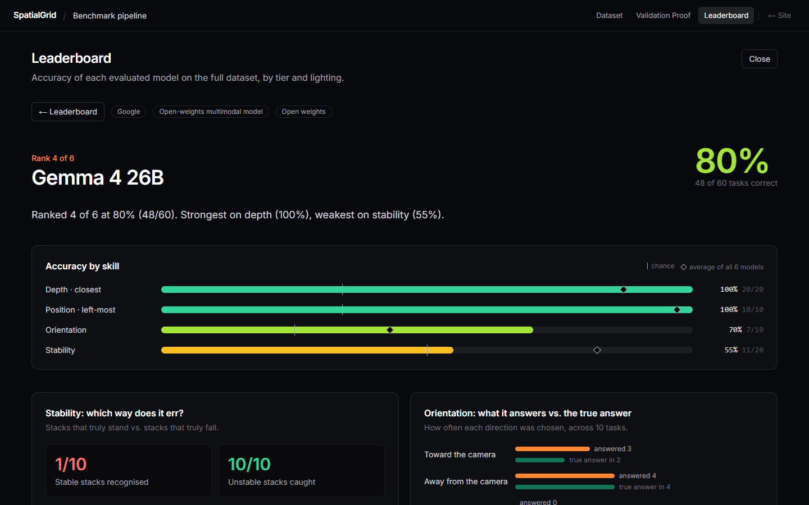
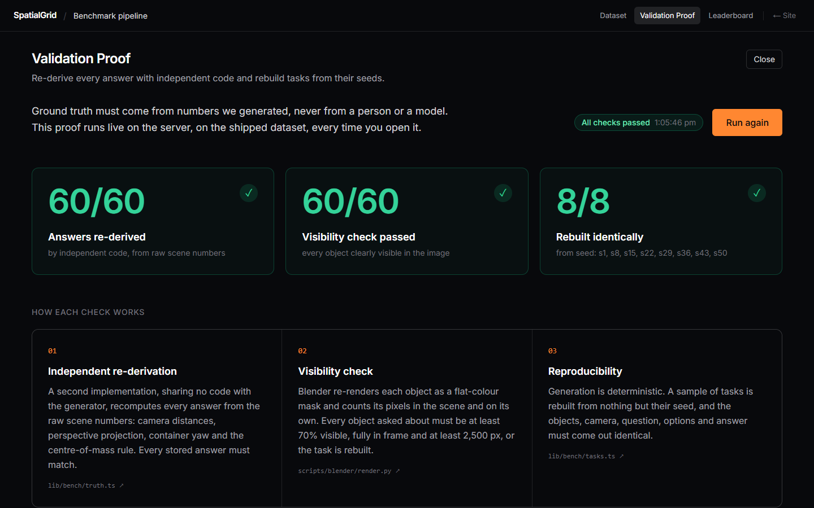
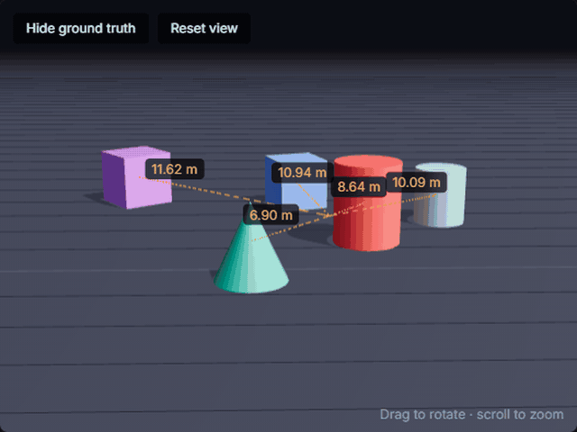
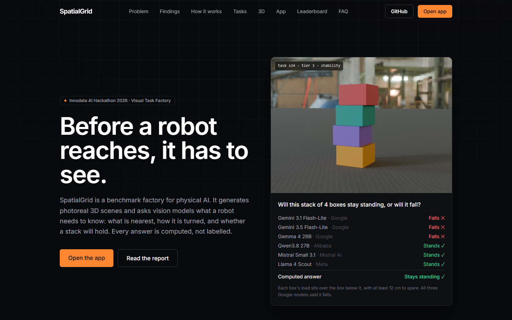
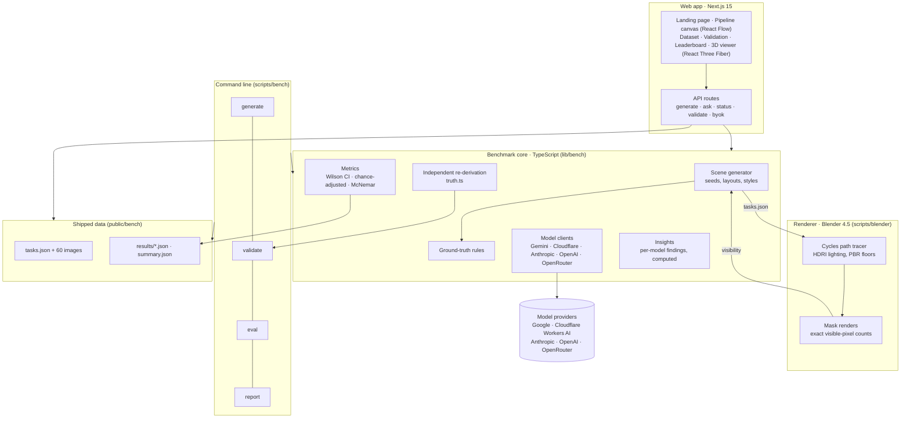

# SpatialGrid: Project Overview

**A visual task factory for spatial and physical reasoning, with answers that are computed rather than labelled**

| | |
|---|---|
| **Team name** | Hackcrew |
| **Team leader** | Mohammed Noufal V |
| **Problem statement** | Visual Task Factory (Innodata AI Hackathon 2026, Track 2) |
| **Repository** | https://github.com/Noufalthecoder/innodata |
| **Team members** | Mohammed Noufal V (team lead), Adithya A M, Karthikeyan M, Devendran P |

> **Before a robot reaches, it has to see.** SpatialGrid generates photoreal 3D scenes and asks vision-language models what a robot or an inspection camera needs to know: *which object is nearest, which way is it turned, will this stack hold?* Every answer is computed from the scene's own numbers before the image is rendered, so no human labels it and no AI judges it.

---

## Contents

1. [Brief about the idea](#1-brief-about-the-idea)
2. [Opportunity: how it is different, how it solves the problem, USP](#2-opportunity)
3. [List of features](#3-list-of-features)
4. [Process flow and use-case diagrams](#4-process-flow-and-use-case-diagrams)
5. [Wireframes and screens](#5-wireframes-and-screens)
6. [Architecture](#6-architecture)
7. [Technologies used](#7-technologies-used)
8. [Implementation cost](#8-implementation-cost)
9. [Hackathon deliverables](#9-hackathon-deliverables)
10. [Results and findings](#10-results-and-findings)
11. [Validation evidence](#11-validation-evidence)
12. [How to run it](#12-how-to-run-it)
13. [Limitations and next steps](#13-limitations-and-next-steps)

---

## 1. Brief about the idea

**The problem.** Vision-language models are being connected to robot arms, warehouse pickers and inspection cameras. Before they can be trusted there, they must be tested on spatial and physical reasoning. Today that means **people labelling images by hand**, which is:

- **slow and expensive:** every image needs a person;
- **error-prone:** for 3D questions ("which way is this container turned?", "is this stack stable?") even careful annotators disagree;
- **static:** a fixed test set can leak into training data and stop measuring anything.

**Our idea.** Reverse the order. SpatialGrid **chooses the scene first**: every object's shape, position and rotation, and the camera. It **computes the answer from those numbers**, and **only then renders a photoreal image**. The label is arithmetic, not opinion. It cannot be wrong, it costs nothing, and the generator can produce as many fresh tasks as needed.

**What a task looks like**

<table>
<tr>
<td width="45%"></td>
<td>

**Task s34 · Tier 3 · Stability**
*Will this stack of 4 boxes stay standing, or will it fall?*
A. It stays standing · B. It falls

**Computed answer: A.** The centre of mass above every box lies over the box below it, by at least 12 cm.

| Model | Answer |
|---|---|
| Gemini 3.1 Flash-Lite (Google) | Falls ❌ |
| Gemini 3.5 Flash-Lite (Google) | Falls ❌ |
| Gemma 4 26B (Google) | Falls ❌ |
| Qwen3.8 27B (Alibaba) | Stands ✅ |
| Mistral Small 3.1 (Mistral AI) | Stands ✅ |
| Llama 4 Scout (Meta) | Stands ✅ |

</td>
</tr>
</table>

---

## 2. Opportunity

### How is it different from existing ideas?

| Typical benchmark | SpatialGrid |
|---|---|
| Real photos labelled by people | Synthetic photoreal scenes whose answer is **computed** from the scene's own numbers |
| Labels can be wrong or disputed | Labels are arithmetic, **re-derived by a second, independent implementation** (60/60 match) |
| Fixed test set that can leak into training | **Generated on demand from a seed.** A fresh, never-seen set can be made at any time, and any task can be rebuilt exactly |
| "Is the answer even visible?" is never checked | **Pixel-level visibility check.** Every object asked about is proven ≥70% visible, fully in frame and ≥2,500 px |
| An LLM often grades free-text answers | **No judge model.** Multiple-choice answers are parsed strictly, and ambiguous replies count as wrong |
| One difficulty level | **Independent difficulty dials:** object count, occlusion, lighting, environment, materials, stack height |

### How does it solve the problem?

1. **Removes the annotator.** The ground truth comes from geometry: camera distance, perspective projection, rotation angle, centre of mass.
2. **Guarantees answerability.** The renderer counts each object's visible pixels against the object drawn alone, and rejects and regenerates any task whose evidence is hidden.
3. **Scales without limit.** One command generates N tasks. Rendering is about 1 minute per image on a laptop CPU, and a fast preview renderer is instant.
4. **Prevents test-data leakage.** A new seed gives a new dataset with the same properties, so a model cannot have memorised it.
5. **Turns results into decisions.** Accuracy per skill, confidence intervals, significance tests and a gallery of every failure show *what* a model cannot do, not just a score.

### USP (unique selling points)

- **Labels that cannot be wrong**, because they are computed before the image exists.
- **Answerable by construction:** visibility is proven per pixel.
- **Zero human labels and zero judge models.**
- **Reproducible:** every task rebuilds identically from its seed.
- **Live and explorable:** every scene can be opened in 3D with its ground truth drawn on, and the whole pipeline runs live in a node-graph app.
- **Model-agnostic:** six models from four companies built in, plus "bring your own key" for any Anthropic, OpenAI, Google or OpenRouter model.

---

## 3. List of features

### Task generation (the factory)
- **Four reasoning kinds across three tiers.** Each needs a different skill, not a reworded question:

| Tier | Kind | Question | How the answer is computed |
|---|---|---|---|
| 1 · Pose | Orientation | Which way does the open side of this container face? | Container yaw, relative to the camera |
| 2 · Relative | Depth | Which object is closest to the camera? | Smallest camera-to-object distance (≥0.8 m lead) |
| 2 · Relative | Position | Which object appears furthest left? | Pinhole projection (≥90 px lead) |
| 3 · Physics | Stability | Will this stack stay standing, or fall? | Centre of mass over each supporting face (≥12 cm margin) |

- **Photoreal rendering:** Blender Cycles path tracing, 6 real-world HDRI environments, 5 PBR floors, and matte, plastic and metal materials.
- **Difficulty dials:** 1–5 objects with partial occlusion, normal or dim light, and 2–4 box stacks with stand/fall outcomes balanced 10/10.
- **Visibility gate:** flat-colour mask renders measure every object, and failing tasks are rebuilt from a new seed.
- **Deterministic seeds:** every task can be regenerated exactly.

### Evaluation (the test runner)
- **Six models evaluated:** Gemini 3.1 Flash-Lite, Gemini 3.5 Flash-Lite and Gemma 4 (Google); Qwen3.8 27B (Alibaba); Mistral Small 3.1 (Mistral AI); Llama 4 Scout (Meta).
- **Fairness:** the same prompt for every model, temperature 0, hidden reasoning off; only the image and the question are sent.
- **Strict reply parser:** ambiguous answers score as wrong. API errors are retried and never counted as wrong.
- **Resumable, quota-aware runs:** a run stops cleanly when a free quota runs out and continues later.
- **Statistics:** accuracy by model, tier, kind, object count and lighting; Wilson 95% confidence intervals; chance-adjusted scores; exact McNemar tests between models.

### Validation and regression testing
- **Independent re-derivation** of every answer by code that shares no logic with the generator.
- **Reproducibility check:** tasks rebuilt from seeds must match exactly.
- **116 automated tests in CI** on every push: rule, property, mutation, prompt-safety, statistics, data-integrity and key-safety tests.

### The web app
- **Pipeline canvas** (node graph): Generate Task → Scene Generator → Rendered Image → Ground Truth Engine → Visibility Check → Model Selector → one lane per model → Results, running live.
- **Bring your own key:** test Claude, GPT-4o or any OpenRouter model with your own key. The key is held in memory only and never stored or logged.
- **Dataset browser:** 60 tasks as photoreal images or interactive 3D with ground-truth overlays, plus export to JSON, CSV or JSONL.
- **Validation Proof:** the three checks, run live.
- **Leaderboard and model deep-dives:** confidence intervals, ties, skill bars against chance, stability and orientation diagnostics, and every task each model missed.
- **Landing page** that explains the problem, the findings and the method.

---

## 4. Process flow and use-case diagrams

### Process flow: one task, end to end



### Use cases



---

## 5. Wireframes and screens

### Pipeline canvas (the app's home screen)

```
┌──────────────────────────────────────────────────────────────────────────────────────────┐
│ SpatialGrid / Benchmark pipeline               Dataset   Validation Proof   Leaderboard  │
├──────────────────────────────────────────────────────────────────────────────────────────┤
│ [Generate Task]──▶[Scene Generator]──▶[Rendered Image]──▶[Ground Truth]──▶[Visibility]   │
│  type/objects/light   seed, camera       photoreal img      computed answer   pixel check  │
│                                                                                  │        │
│ [Model Config]─────────────▶[Model Selector]──┬──▶[Gemini]  ✓ ──┐                │        │
│  provider/model/key            toggles   ▲    ├──▶[Llama 4] ✓ ──┤                │        │
│  [Test Key] ● valid                ▲─────┼────├──▶[Mistral] ✓ ──┼──▶[Results 4/5]│        │
│                                          │    ├──▶[Qwen]    ✓ ──┤    per-model ✓/✕        │
│                                          └────┘──▶[Your model] ✕┘                         │
└──────────────────────────────────────────────────────────────────────────────────────────┘
```

| Screen | Screenshot |
|---|---|
| Pipeline running live |  |
| Leaderboard (confidence intervals, ties) |  |
| Model deep-dive |  |
| Validation Proof |  |
| Scene in 3D with ground truth |  |
| Landing page |  |

There is also a **command-line interface** for every pipeline step: `bench:generate`, `bench:validate`, `bench:eval`, `bench:report` and `bench:reparse` (see [§12](#12-how-to-run-it)).

---

## 6. Architecture



**Security design (bring your own key).** A visitor's key lives in browser memory only. It travels in the single request that needs it, and the server passes it straight to the provider. It is never stored, logged or returned, and provider errors that quote it are masked. Keys go only to fixed provider hosts, and model ids are checked against a strict pattern.

---

## 7. Technologies used

| Layer | Technology | Why |
|---|---|---|
| Benchmark core and CLI | **TypeScript**, Node.js, tsx | One language for the generator, evaluator and web app; strict types |
| Photoreal rendering | **Blender 4.5 LTS (Cycles)**, Python `bpy` script | Path-traced realism, plus exact per-object visibility masks |
| Assets | **Poly Haven** HDRIs and PBR textures (CC0) | Real-world lighting, free to use |
| Web app | **Next.js 15**, React 19, Tailwind CSS, Framer Motion | Landing page, app and API routes in one project |
| Pipeline canvas | **React Flow** (`@xyflow/react`) | Live node-graph view of the pipeline |
| 3D viewer | **React Three Fiber**, drei, three.js | Rebuilds any scene in 3D with ground truth drawn on |
| Models (free tiers) | **Gemini API** (Gemini, Gemma); **Cloudflare Workers AI** (Qwen, Mistral, Llama 4) | Six models from four companies at zero cost |
| Models (optional) | Anthropic, OpenAI, OpenRouter APIs | Supported in code, and through bring your own key |
| Testing | **vitest** (116 tests), GitHub Actions CI | Runs on every push |
| Video tooling | Playwright, ffmpeg, Gemini text-to-speech | Automated demo recording with zoom and subtitles |

*Note:* an early plan mentioned Python, pytest and the Claude Code API. We built the evaluator in TypeScript with vitest so that the generator, the evaluator and the web app share one codebase. Claude is supported as a model provider rather than used as a runtime dependency.

---

## 8. Implementation cost

| Item | Cost |
|---|---|
| Model evaluation: 6 models × 60 tasks (360 answers) | **$0** (Gemini API and Cloudflare Workers AI free tiers) |
| Rendering: 60 photoreal images | **$0** (Blender on a laptop CPU, about 1 minute per image) |
| Lighting and material assets | **$0** (Poly Haven, CC0) |
| Hosting, CI, tooling | **$0** (open-source stack, GitHub Actions) |
| **Total spent** | **$0** |

**Scaling cost.** A new 60-task set costs about an hour of CPU rendering plus free-tier API calls, and the instant preview renderer needs no Blender. Paid models (Claude, GPT-4o) can be added at the provider's per-request price, or tested by judges with their own keys at no cost to us.

---

## 9. Hackathon deliverables

| Requirement | Where |
|---|---|
| **Runnable source code** | This repository. `npm install && npm run dev`; CLI in `scripts/bench/` |
| **Sample task packages** | `public/bench/tasks.json` (60 tasks with question, options, answer, explanation, camera, objects and visibility) and `public/bench/images/` |
| **Model outputs** | `public/bench/results/*.json` (every raw reply, parsed choice and score) and `public/bench/summary.json` |
| **Validation test logs** | `npm run bench:validate` (60/60 re-derived, 60/60 visible, reproducible from seeds); `npm test` (116 tests); the GitHub Actions CI history |
| **Technical documentation** | [`README.md`](../README.md), [`docs/TECHNICAL_REPORT.md`](TECHNICAL_REPORT.md) and this overview |
| **Findings on strengths and weaknesses** | [§10](#10-results-and-findings), the technical report, and the in-app leaderboard and model deep-dives |
| **Live working prototype** | `/app`: the live pipeline, dataset, validation proof and leaderboard |
| **Demo** | The demo video, plus the automated recording pipeline in `scripts/demo/` |

---

## 10. Results and findings

Six models, 60 photoreal tasks each, identical prompt, temperature 0.

| # | Model | Company | Overall · 95% CI | Above chance | Orientation | Depth & position | Stability | Dim light |
|:-:|---|---|:-:|:-:|:-:|:-:|:-:|:-:|
| 1 | Qwen3.8 27B | Alibaba · open | **88.3%** · 78–94 | 81% | 50% | 97% | 95% | 92% |
| 2 | Gemini 3.1 Flash-Lite | Google | **81.7%** · 70–89 | 71% | 50% | 97% | 75% | 100% |
| 2 | Mistral Small 3.1 24B | Mistral AI · open | **81.7%** · 70–89 | 71% | 30% | 90% | 95% | 75% |
| 4 | Gemma 4 26B | Google · open | **80.0%** · 68–88 | 68% | 70% | 100% | 55% | 83% |
| 5 | Gemini 3.5 Flash-Lite | Google | **75.0%** · 63–84 | 60% | 20% | 90% | 80% | 83% |
| 6 | Llama 4 Scout 17B | Meta · open | **70.0%** · 57–80 | 52% | 40% | 67% | 90% | 75% |

**Strengths**
- **Depth and position are nearly solved:** 90% on average. Five of the six models score 90–100% even with five objects and occlusion.
- **Qwen, Mistral and Llama judge stability well.** All three recognised all 10 stable stacks and caught 8–9 of the 10 unstable ones.

**Weaknesses**
- **Orientation is broken for every company's model:** 43% on average, against 25% for guessing. Of 60 orientation answers, only one said "left" or "right", although those are correct in 4 of the 10 tasks.
- **Google's models over-predict collapse.** They caught every unstable stack but recognised only 1–6 of the 10 stable ones. This is a family-specific bias that a single-vendor test would hide.
- **Three scenes defeated all six models** (s9, s27, s57): containers whose open side faces right.

**Statistical honesty.** Qwen scored highest. On paired answers (exact McNemar test) its lead is significant over Llama 4 (p = 0.007) and Gemini 3.5 Flash-Lite (p = 0.02), but not over Mistral, Gemini 3.1 or Gemma (p ≈ 0.27–0.29). With 60 tasks, those four are statistically tied.

**Real-world impact**

| Model error | Consequence |
|---|---|
| Wrong orientation | A gripper approaches a container from its closed side and fails to grasp |
| Safe stack called unsafe | An inspection system halts a production line for nothing |
| Wrong depth order | A robot arm reaches for the wrong item, or hits one it did not see |

---

## 11. Validation evidence

| Check | Result |
|---|:-:|
| Answers re-derived by independent code (`lib/bench/truth.ts`) | **60 / 60** |
| Tasks rebuilt identically from their seeds | **60 / 60** |
| Visibility check passed | **60 / 60** |
| Automated tests (vitest, CI on every push) | **116 / 116** |

What the tests cover:
- **Rules:** hand-computed cases for every task kind, including perspective effects.
- **Property tests:** the generator and the independent re-derivation agree on 500 random stacks.
- **Mutation tests:** corrupted answers and altered scenes are detected.
- **Prompt safety:** the answer never reaches a model, and ambiguous replies are rejected.
- **Statistics:** Wilson intervals, chance adjustment and McNemar tests.
- **Data integrity:** every figure shown in the app is recomputed from stored answers and must match the report, and hand-written notes may not contain numbers.
- **Key safety:** bring-your-own keys are never stored, logged or echoed.

**Bugs the tests caught:**
1. A regex error turned "Answer: D" into "no answer".
2. A generator bias made 19 of 20 stacks stand, so a model that always said "stands" would have scored 95%. The outcomes are now balanced and the balance is enforced by a test.

---

## 12. How to run it

```bash
npm install
cp .env.example .env.local      # add GEMINI_API_KEY (free); optionally CLOUDFLARE_ACCOUNT_ID + CLOUDFLARE_API_TOKEN (free)
npm run dev                      # site at http://localhost:3000, app at /app
```

```bash
npm run bench:generate -- --count 60 --seed 1                              # photoreal (needs BLENDER_PATH) or --renderer svg
npm run bench:validate                                                     # independent re-derivation + reproducibility
npm run bench:eval -- --model gemini --model-id gemini-3.1-flash-lite      # Google
npm run bench:eval -- --model cloudflare --model-id @cf/qwen/qwen3.8-27b   # open models
npm run bench:report                                                       # summary.json with CIs and significance
npm test                                                                   # 116 tests
```

---

## 13. Limitations and next steps

**Limitations (stated honestly)**
- **Synthetic scenes:** controlled by design, but not photographs of real warehouses.
- **Simplified stability:** a centre-of-mass rule for equal-size, equal-density boxes, not a full physics simulation.
- **Sample size:** 60 tasks give wide intervals per skill, which is why the leaderboard reports ties.
- **Closed commercial models:** Claude and GPT-4o are supported, but were not part of our evaluation for cost reasons.

**Next steps**
- Scale to 1,000+ tasks to narrow the confidence intervals and separate the statistically tied models.
- Add controlled-variation sweeps, such as accuracy against rotation angle, to map exactly where orientation breaks.
- New task kinds: containment, support relations, reachability, and multi-view consistency.
- Physics-simulated stability for mixed sizes and masses.
- Publish task packs on Hugging Face (the JSONL export already exists) for public, leak-resistant evaluation.
